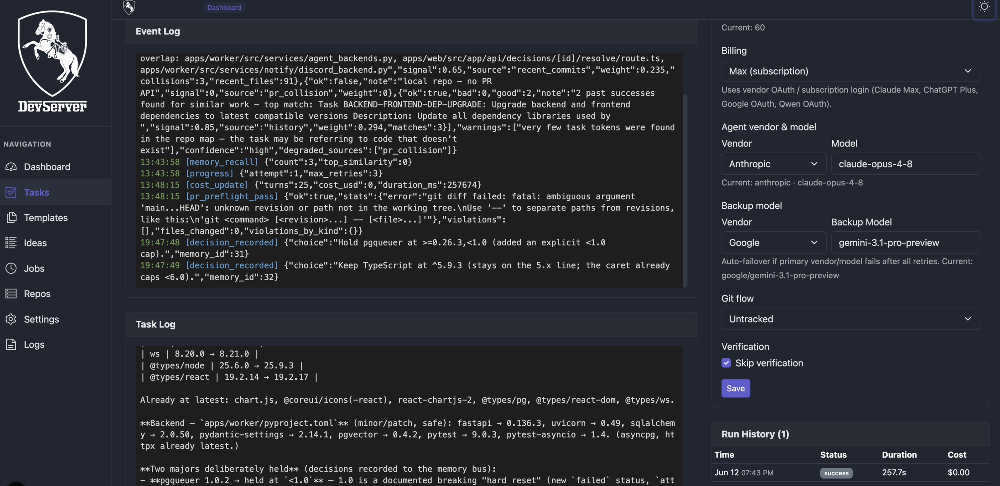
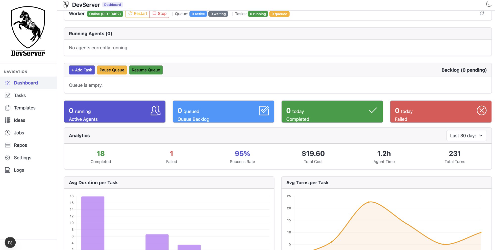
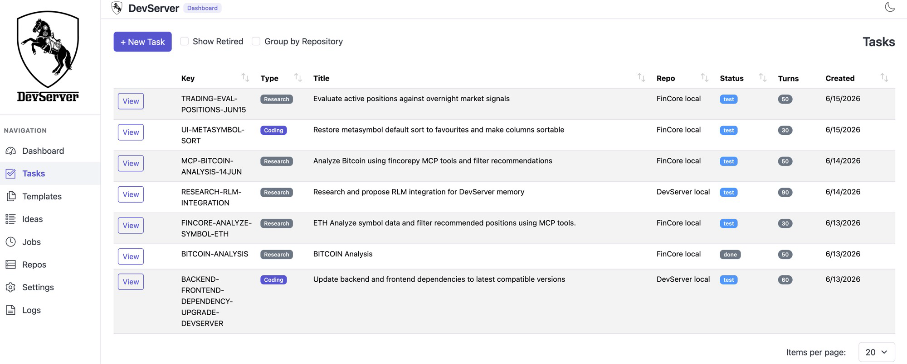
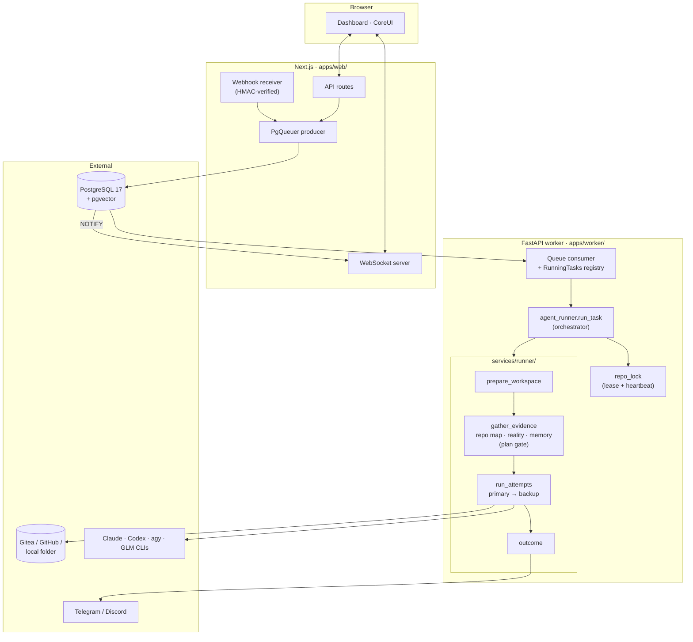
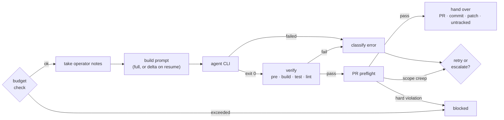

<div align="center">

# DevServer

### Task in. Pull request out.

**Claude Code, Codex, Gemini and GLM are the engines. DevServer is the pipeline around them. Hand it a task. It gives the agent its own copy of the code, checks the work with your build, your tests and your linter, and hands you a pull request. Open source. On your machine. Yours to change.**

[](https://github.com/sergiovision/DevServer/actions/workflows/ci.yml)
[](LICENSE)
[](https://python.org/)
[](https://nextjs.org/)
[](https://postgresql.org/)
[](docker/)

**DevServer grew up. Its name is now [DevAgentForce →](https://github.com/sergiovision/DevAgentForce)**



[The idea](#the-idea) · [How it works](#how-it-works) · [Features](#what-you-get) · [Security](#your-keys-stay-home) · [Make it yours](#start-here-make-it-yours) · [Engineering](#engineering-highlights) · [Architecture](#architecture) · [Quick Start](#quick-start) · [Docs](#documentation)

**4 agent CLIs · 3 git hosts · 1 database · 0 servers in the middle · MIT licensed**

</div>

---

## The idea

The best coding agents in the world live in a terminal. They are astonishing. And they have one problem.

They need you. One task at a time, one window at a time, while you sit there and watch.

So here is a simple question. What if you could just hand over the work?

Give an agent a task. Give it its own copy of the code. Run your build, your tests and your linter. If the work passes, open a pull request. If it fails, tell the agent exactly why, and let it try again.

That's the whole idea.

## How it works

Take the wheel, or let it run. Either way, you only see work that already passes.

| | Step | What happens |
|---|---|---|
| **01** | **Hand it a task** | Type it in the dashboard. Or start it from a template, a cron schedule, a signed webhook, a Confluence page, another agent over A2A, or your own CLI over MCP. |
| **02** | **An agent picks it up** | Claude, Codex, Gemini or GLM, in a worktree of its own. Before it writes a line, it gets a map of the repo, a reality score and what past tasks learned. |
| **03** | **Your checks decide** | Your build, tests and lint run. A preflight scans for leaked secrets, oversize files and scope creep. Nothing is taken on trust. |
| **04** | **A pull request appears** | On GitHub or Gitea, or as `.patch` files, or as changes in your local folder. You review. You merge. |

**And when it fails?** The error is matched against 20+ rules and the next attempt gets a precise hint. The same failure twice escalates instead of burning retries. Out of retries? A backup vendor takes over.

## What you get

| | |
|---|---|
| **Every major agent. One queue.**<br/>Claude, Codex, Gemini through Antigravity, and GLM, behind one interface. Pick one per task. Ask for `claude-opus-latest` and get the newest model the day it ships. | **Pay the way you already pay.**<br/>Use a metered API key, or the Claude Max, ChatGPT or Google AI subscription you already have. Set it per task. |
| **Verified before you see it.**<br/>Your build, your tests, your linter, in an isolated git worktree. Only passing work becomes a pull request. | **Knows when to say no.**<br/>A 0–100 reality score checks the code base before a token is spent. Turn on the abstain gate, and doomed tasks never start. |
| **You stay in charge.**<br/>Agree on the plan before a line is written, from the dashboard or a Telegram button. The approved file list becomes a fence the agent can't cross. | **Budgets that actually stop.**<br/>Set a cost or wall-time ceiling per task. A warning at 80%. A hard stop at 100%. |
| **Talk to a running agent.**<br/>Send a note, or start a two-way thread with the agent while it works. Reply from Telegram. Cancel for real: the agent's whole process group goes with it. | **Every task makes the next one smarter.**<br/>Past tasks are recalled with hybrid vector and full-text search. Each repo keeps its facts and decisions. Embeddings run locally, with no cloud key. |
| **Work while you sleep.**<br/>Cron jobs, an overnight Night Cycle, HMAC-signed webhooks and Confluence import keep the queue full. | **Speaks to other agents.**<br/>An MCP server puts the task queue inside Claude Code, Codex or Gemini. An A2A gateway lets other agents delegate work, under quotas you set. |
| **Ask. It already knows.**<br/>An assistant on every page that knows the screen you're on. It proposes actions; nothing runs until you approve. | **See everything, live.**<br/>Every step is a typed event, streamed to your browser in about 100 ms. Analytics, cost per pull request, and every Claude Code and Codex session on the host in one view. |

<table>
<tr>
<td width="50%"><a href="assets/dashboard.png"></a><br/><sub><b>Dashboard</b>: live queue, cost per PR, success rate</sub></td>
<td width="50%"><a href="assets/tasks.png"></a><br/><sub><b>Tasks</b>: backlog grid or a kanban pipeline board</sub></td>
</tr>
</table>

Five kinds of work share the queue: **coding**, **test**, **script**, **skill** and **research**. Every screen and subsystem, with screenshots and source links: **[docs/features.md](docs/features.md)**.

## Your keys stay home.

Left alone, a coding agent will paste a key into a commit and never notice. DevServer is built to catch it.

| | |
|---|---|
| **Checked before every push.**<br/>A deterministic preflight scans every diff for secrets and oversize files, and checks the commit author. No LLM involved. A hit stops the pull request. | **Scrubbed on the way out.**<br/>Messages between agents, session transcripts, assistant output and everything sent to an A2A peer go through the same secret rules first. |
| **Nothing reaches the worker from outside.**<br/>The worker binds to `127.0.0.1`. Outside callers go through the web tier, with hashed peer tokens and an SSRF guard on every push. | **Risky moves wait for you.**<br/>An agent about to touch the outside world can be made to ask first. The task waits until you decide, in the dashboard or on Telegram. |
| **Your folder, untouched.**<br/>Point it at a local clone. It never pushes, never resets, never cleans. Your git config stays yours. | **Self-hosted. No middleman.**<br/>Your code goes straight from your machine to your AI vendor. No account, no telemetry home. Lock the dashboard with one optional admin token. |

## Start here. Make it yours.

DevServer is a minimum viable product, on purpose. Minimum doesn't mean unfinished. It means everything that wasn't essential was left out, and everything that's left works: the queue, the worktree, the agent, the verifier, the pull request.

Every team builds software differently. Your checks aren't mine. Your rules aren't mine. A pipeline you can't change is a pipeline you'll eventually stop using.

So DevServer is MIT licensed and written to be read. Fork it. Then change the parts that make your team yours.

| You want to | Start here |
|---|---|
| Add an agent vendor | `AgentBackend` in [`agent_backends.py`](apps/worker/src/services/agent_backends.py) |
| Decide what "done" means | [`verifier.py`](apps/worker/src/services/verifier.py) |
| Decide what must never ship | [`pr_preflight.py`](apps/worker/src/services/pr_preflight.py) |
| Shape what the agent knows before it starts | [`runner/evidence.py`](apps/worker/src/services/runner/evidence.py), [`runner/prompt.py`](apps/worker/src/services/runner/prompt.py) |
| Start work from your own tools | Webhook triggers, cron, or the [MCP server](apps/mcp-memory/README.md) |

## Engineering highlights

Readable first. Then reviewable. Then correct. Then features. Performance is deliberately not a goal.

| Concern | How it is solved | Where |
|---|---|---|
| A 1,600-line `run_task` | A ~30-line `run_task` orchestrating small phase functions sharing one `TaskContext`; primary and backup models go through the *same* `run_attempts()` | [`agent_runner.py`](apps/worker/src/services/agent_runner.py), [`services/runner/`](apps/worker/src/services/runner/) |
| "Did the refactor change behaviour?" | Characterisation tests drive the real runner against real PostgreSQL, a temp git repo and a scripted fake agent subprocess | [`tests/runner/`](apps/worker/tests/runner/) |
| Cancel only relabelled the task | A `RunningTasks` registry cancels the `asyncio.Task`; `proc.run` kills the agent's whole process group; the runner always writes a terminal status | [`running_tasks.py`](apps/worker/src/services/running_tasks.py), [`proc.py`](apps/worker/src/services/proc.py), [`task_control.py`](apps/worker/src/services/task_control.py) |
| Locks that could be stolen or leak | Repo locks are **leases**: an owner, a short TTL and a heartbeat; release deletes only the caller's row; a busy repo re-queues the job instead of failing it | [`repo_lock.py`](apps/worker/src/services/repo_lock.py), [`queue_consumer.py`](apps/worker/src/services/queue_consumer.py) |
| Model IDs copied across Python and TypeScript | One typed registry (`ModelInfo`) served at `/internal/agent-registry`; the web app renders every picker from it; floating aliases (`claude-opus-latest`) are resolved by version at spawn time, so a model release is one line | [`agent_backends.py`](apps/worker/src/services/agent_backends.py), [`agent-vendors.ts`](apps/web/src/lib/agent-vendors.ts), [`model_aliases.py`](apps/worker/src/services/model_aliases.py) |
| Four hand-rolled retry loops | One `retry_async(fn, attempts=, backoff=Backoff(...), retry_on=)` | [`retry.py`](apps/worker/src/services/retry.py) |
| DB sessions pinned for an hour per task | Repository-style functions, one short session per unit of work; nothing holds a session across a subprocess | [`runner/store.py`](apps/worker/src/services/runner/store.py) |
| Hung git remotes | Every git call takes a required, per-operation timeout | [`git_ops.py`](apps/worker/src/services/git_ops.py) |

Tooling: `ruff` (lint + format, blocking), `pyright` basic (reported), `pytest` with real-database integration tests, and Node's test runner for the web's pure modules. [GitHub Actions](.github/workflows/ci.yml) runs all of it on every push. The walkthrough is in [`docs/architecture.md`](docs/architecture.md); the reasoning is in [`docs/design-decisions.md`](docs/design-decisions.md).

## Architecture



Two services. One PostgreSQL. No Redis, no RabbitMQ, no Celery: **PgQueuer** lives in the same database as everything else.

### One attempt



Every exit of an attempt is a `Verdict` (`SUCCEEDED`, `RETRY`, `ESCALATE`, `BLOCKED`, `BUDGET_EXCEEDED`, `SUSPENDED`); the attempt loop and [`outcome.record`](apps/worker/src/services/runner/outcome.py) are a `match` over that enum. Every module is walked through in [`docs/architecture.md`](docs/architecture.md).

## Tech Stack

| Layer | Choice | Why |
|---|---|---|
| **Frontend** | Next.js 16 App Router · React 19 · CoreUI | Server components for task pages, client components for real-time panels. |
| **Backend worker** | Python 3.14 · FastAPI · SQLAlchemy 2.0 async · asyncpg | Async top to bottom. Every subprocess, DB call and agent run is non-blocking. |
| **Job queue** | [PgQueuer](https://github.com/janbjorge/pgqueuer) | A PostgreSQL-native queue. One fewer service to run. |
| **Database** | PostgreSQL 17 + pgvector | Records, queue, vectors and real-time notifications in one store. |
| **Real-time** | `LISTEN/NOTIFY` → WebSocket | Zero-dependency pub/sub. Updates arrive in about 100 ms. |
| **AI engines** | Claude, Codex, Gemini (Antigravity), GLM CLIs | DevServer *orchestrates* the CLIs you already trust instead of rebuilding them. |
| **Embeddings** | `fastembed` (local, ONNX/CPU) | No cloud API, no key. Default `BAAI/bge-base-en-v1.5` (768-dim), override with `EMBEDDING_MODEL`. |
| **Git platform** | GitHub / Gitea / Forgejo / Local Git | Pull requests through the REST APIs, or a plain local clone with no API and no tokens. |
| **Notifications** | Telegram · Discord · A2A push | Rich task cards, plan buttons and replies on Telegram. |
| **Package mgmt** | `uv` (Python) · `npm` (Node) | Fast, cacheable, boring. |

## Quick Start

You need Node.js 22+, Python 3.14+, PostgreSQL 16+ with `pgvector`, [`uv`](https://docs.astral.sh/uv/), and one agent CLI signed in (for example `claude login`).

```bash
git clone https://github.com/sergiovision/DevServer.git
cd DevServer
cp config/.env.example .env   # minimum: PGPASSWORD and one vendor key (or a CLI subscription login)

./scripts/migrate.sh          # idempotent schema migration
./scripts/start.sh --dev      # worker + web in dev mode
```

Open **http://localhost:3200**. Prefer Docker? `./scripts/start.sh --docker`.

Both Docker topologies, host PostgreSQL, subscription logins inside containers, Windows and upgrades are in **[docs/quick-start.md](docs/quick-start.md)**.

## Development

```bash
cd apps/worker
uv sync --extra test
uv run ruff check . && uv run ruff format --check .   # blocking
uv run pyright                                         # basic mode, reported
uv run pytest                                          # needs a local PostgreSQL for tests/runner
```

The integration tests create and migrate `devserver_test` on first use (override with `DEVSERVER_TEST_DATABASE_URL`). With no server reachable they are skipped, and the unit tests still run.

```bash
cd apps/web
npm test
npx tsc --noEmit
npm run build
```

CI ([`.github/workflows/ci.yml`](.github/workflows/ci.yml)) runs the same commands against a `pgvector/pgvector:pg17` service. Read [CONTRIBUTING.md](CONTRIBUTING.md) before opening a pull request.

## Project Layout

```
apps/
  web/          → Next.js dashboard, API routes, PgQueuer producer, WebSocket relay, webhooks, A2A gateway
  worker/       → FastAPI worker: queue consumer, task runner (src/services/runner/), agent backends, guardrails
  mcp-memory/   → MCP server that lets coding CLIs create and run DevServer tasks
database/       → idempotent SQL migrations
docker/         → one Dockerfile (--target web|worker) + compose files
scripts/        → build / start / stop / migrate / backup / restore (bash and PowerShell)
docs/           → architecture, design decisions, features, quick start, backup
```

## Documentation

| Document | Contents |
|---|---|
| [Quick Start](docs/quick-start.md) | Local, Docker and Windows setup; upgrading |
| [Features](docs/features.md) | Every screen and subsystem, with screenshots |
| [Architecture](docs/architecture.md) | How a task becomes a pull request, module by module |
| [Design Decisions](docs/design-decisions.md) | Multi-vendor backends, failover, error-class retries, rate limits, OpenTelemetry, patterns |
| [Backup & Restore](docs/backup-restore.md) | Full-system backup and restore scripts |
| [Releases](https://github.com/sergiovision/DevServer/releases) | What changed in each version |

## Roadmap

**Shipped.** Everything above is implemented and covered by tests.

**Next:**

- Make `pyright` blocking once the remaining basic-mode findings in older modules are fixed.
- GPT-6.1 Sol / Terra, GPT-6 Luna and GPT-6 Pro in the registry as soon as the Codex CLI catalogue lists them.

**Left out, on purpose:**

- **Parallel sub-agents per task.** Worktrees are already per task; sub-worktrees add complexity with unclear value at this scale.
- **A sandboxed container per task.** It overlaps with the worktree and repo-lock isolation already in place.
- **A typed code graph.** The repo map captures most of the value at a fraction of the effort.

Issues and contributions are welcome. See [CONTRIBUTING.md](CONTRIBUTING.md) and [SECURITY.md](SECURITY.md).

## Then it grew up.

DevServer proved the idea. Then the real work began.

The worker was rewritten in Go. The setup shrank to one command. And it got a new name: **[DevAgentForce](https://github.com/sergiovision/DevAgentForce)**.

| | DevServer | DevAgentForce |
|---|---|---|
| **What it is** | The open-source MVP | The finished product |
| **Made for** | Building your own pipeline | Shipping with agents today |
| **Price** | Free, MIT licensed | Free edition. Pro is $15 a month |
| **Source** | Open. Read it, fork it | Proprietary |
| **Install** | Clone, then set up Node, Python and PostgreSQL | One command, or a native desktop app |
| **Worker** | Python | Go |

**[Compare the editions](https://capitaltools.app/devagentforce#editions) · [Install it free](https://capitaltools.app/devagentforce#install)**

### Hiring? Leading an engineering team?

This is what one engineer can ship in the AI age.

I'm Sergei Zhuravlev. I started DevServer in April 2026. Seven months later it's a commercial product: a licence server, a checkout, installers for macOS, Linux and Windows, a native desktop app in Rust, an interface in nine languages.

Don't take my word for it. The code is right here. Start with [Engineering highlights](#engineering-highlights), then read the [design decisions](docs/design-decisions.md). Then let's talk: [LinkedIn](https://www.linkedin.com/in/sergeizhuravlev/) · [hi@sergego.com](mailto:hi@sergego.com).

## License

[MIT](LICENSE). Free for personal and commercial use. Attribution appreciated, never required.

---

<div align="center">

### Built by Sergei Zhuravlev
[DevAgentForce](https://github.com/sergiovision/DevAgentForce) · [LinkedIn](https://www.linkedin.com/in/sergeizhuravlev/) · [GitHub](https://github.com/sergiovision) · [hi@sergego.com](mailto:hi@sergego.com)
</div>
