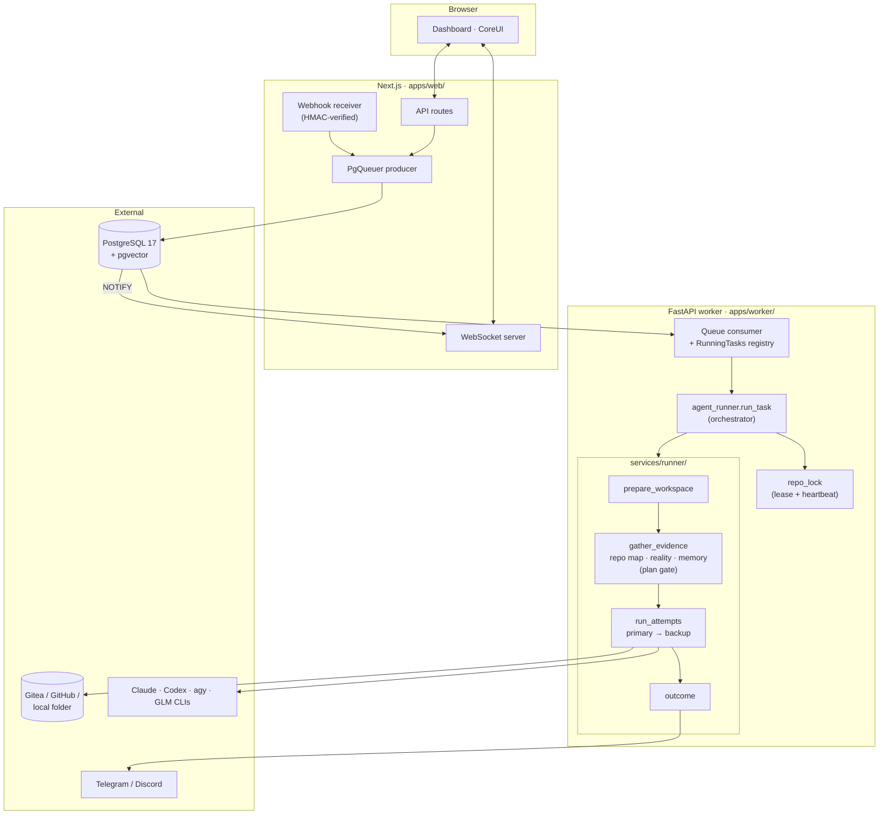
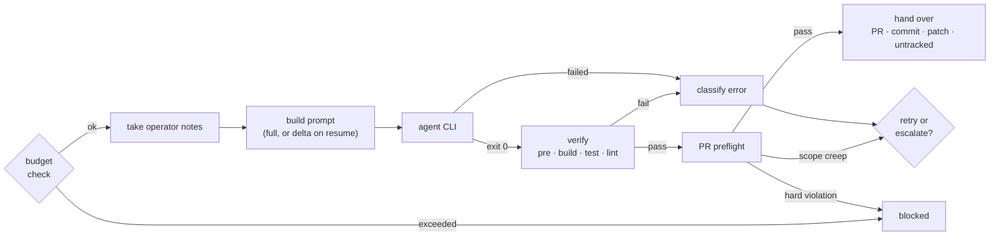

<div align="center">

# DevServer

### A self-hosted pipeline that runs AI coding agents and opens pull requests.

**It dispatches coding tasks, runs Claude Code, Codex, Gemini (Antigravity) or GLM in an isolated git worktree, verifies build/test/lint and opens a pull request on GitHub or Gitea. You can also point it at any local git folder: no remote, no tokens, works with every git provider.**

[](https://github.com/sergiovision/DevServer/actions/workflows/ci.yml)
[](LICENSE)
[](https://python.org/)
[](https://nextjs.org/)
[](https://postgresql.org/)
[](docker/)


[Why](#why-devserver) · [Engineering](#engineering-highlights) · [Features](#features) · [Architecture](#architecture) · [Quick Start](#quick-start) · [Development](#development) · [Docs](#documentation) · [Roadmap](#roadmap)

</div>

---

## Why DevServer?

Most autonomous coding agents ship as a closed SaaS, a VS Code extension, or a CLI glued to GitHub. DevServer is the opposite: a **self-hosted harness** that runs the coding-agent CLIs you already use (Claude Code, Codex, Antigravity, GLM) as supervised workers — with a queue, a verifier, guardrails, an audit trail and a dashboard around them.

- **Multi-vendor agent backends.** Claude (Anthropic), Gemini via Google's Antigravity CLI, Codex (OpenAI) and GLM (Zhipu), behind one `AgentBackend` interface. Switch per task; fail over to a backup vendor or model automatically when retries run out.
- **Pay by API key or by subscription.** Per-task billing mode: `api` (metered key) or `max` (Claude Max, ChatGPT Plus, Google AI Pro/Ultra through the CLI's own login).
- **Evidence before action.** A repo map, a 0–100 reality score and hybrid memory recall go into the prompt before the agent writes a line; an opt-in abstain gate blocks tasks the code base cannot support.
- **Error-class-aware retries.** Failures are classified by 20+ rules and the next attempt gets a targeted hint. The same error twice escalates instead of burning retries.
- **Guardrails without extra LLM calls.** Budget circuit breaker, deterministic PR preflight (secrets, forbidden and oversize files, author), side-effect approval gate.
- **Human in the loop where it matters.** Plan approval for interactive tasks, operator notes delivered to a running agent, real cancellation that kills the agent process.
- **Full live observability.** Every step is a typed event: PostgreSQL `NOTIFY` → WebSocket → dashboard, plus opt-in OpenTelemetry export.

All of the above are real, tested code paths. The sections below and the [`docs/`](docs/) folder show how they are built.

## Engineering highlights

DevServer is also a showcase of how to build an **agent harness** that stays readable as it grows. The priorities, in order: **readability → reviewability → correctness → features**. Performance is deliberately not a goal.

| Concern | How it is solved | Where |
|---|---|---|
| A 1,600-line `run_task` | A ~30-line `run_task` orchestrating small phase functions sharing one `TaskContext`; primary and backup models go through the *same* `run_attempts()` | [`agent_runner.py`](apps/worker/src/services/agent_runner.py), [`services/runner/`](apps/worker/src/services/runner/) |
| "Did the refactor change behaviour?" | Characterisation tests drive the real runner against real PostgreSQL, a temp git repo and a scripted fake agent subprocess | [`tests/runner/`](apps/worker/tests/runner/) |
| Cancel only relabelled the task | A `RunningTasks` registry cancels the `asyncio.Task`; `proc.run` kills the agent's whole process group; the runner always writes a terminal status | [`running_tasks.py`](apps/worker/src/services/running_tasks.py), [`proc.py`](apps/worker/src/services/proc.py), [`task_control.py`](apps/worker/src/services/task_control.py) |
| Locks that could be stolen or leak | Repo locks are **leases**: an owner, a short TTL and a heartbeat; release deletes only the caller's row; a busy repo re-queues the job instead of failing it | [`repo_lock.py`](apps/worker/src/services/repo_lock.py), [`queue_consumer.py`](apps/worker/src/services/queue_consumer.py) |
| Model IDs copied across Python and TypeScript | One typed registry (`ModelInfo`) served at `/internal/agent-registry`; the web app renders every picker from it | [`agent_backends.py`](apps/worker/src/services/agent_backends.py), [`agent-vendors.ts`](apps/web/src/lib/agent-vendors.ts) |
| Four hand-rolled retry loops | One `retry_async(fn, attempts=, backoff=Backoff(...), retry_on=)` | [`retry.py`](apps/worker/src/services/retry.py) |
| DB sessions pinned for an hour per task | Repository-style functions, one short session per unit of work; nothing holds a session across a subprocess | [`runner/store.py`](apps/worker/src/services/runner/store.py) |
| Hung git remotes | Every git call takes a required, per-operation timeout | [`git_ops.py`](apps/worker/src/services/git_ops.py) |

Tooling: `ruff` (lint + format, blocking), `pyright` basic (reported), `pytest` with real-database integration tests, Node's test runner for the web's pure modules, all run by [GitHub Actions](.github/workflows/ci.yml) on every push. The design walkthrough is in [`docs/architecture.md`](docs/architecture.md) and the reasoning behind it in [`docs/design-decisions.md`](docs/design-decisions.md).

## Features

<table>
<tr>
<td width="50%"><a href="assets/dashboard.png"></a><br/><sub><b>Dashboard</b>: live queue, cost per PR, success rate</sub></td>
<td width="50%"><a href="assets/tasks.png"></a><br/><sub><b>Tasks</b>: backlog grid or a kanban pipeline board</sub></td>
</tr>
</table>

| Area | What you get |
|---|---|
| **Task pipeline** | Queue → isolated worktree → agent CLI → verify (build/test/lint) → PR preflight → PR, direct commit, `.patch` files or untracked changes |
| **Repositories** | GitHub (incl. Enterprise), Gitea/Forgejo, or **Local Git**: any local clone, no tokens, never pushes |
| **Agents** | Claude, Codex, Gemini via Antigravity, GLM; per-task vendor/model, backup model for auto-failover, API-key or subscription billing |
| **Guardrails** | Reality gate (0–100 evidence score), budget circuit breaker, secret/forbidden-file preflight, Plan Gate approval |
| **Human in the loop** | Plan approval, Task Notes delivered to a running agent, real cancellation, Telegram/Discord notifications |
| **Memory** | Hybrid pgvector + full-text recall of past tasks, fused with Reciprocal Rank Fusion, local embeddings |
| **Automation** | Cron jobs, HMAC-signed webhook triggers, Confluence import, MCP server for Claude Code / Codex / Gemini |
| **Observability** | Typed events over `NOTIFY` → WebSocket, live logs, analytics, opt-in OpenTelemetry export |
| **Product extras** | Task templates, an ideas tree, a Mermaid module diagram per repo, an *Ask Agent* help assistant |

Every screen and subsystem, with screenshots and source links: **[docs/features.md](docs/features.md)**.

## Architecture



Three small services, one PostgreSQL. No Redis, no RabbitMQ, no Celery — **PgQueuer** uses the same database everything else lives in.

### One attempt



Every exit of an attempt is a `Verdict` (`SUCCEEDED`, `RETRY`, `ESCALATE`, `BLOCKED`, `BUDGET_EXCEEDED`, `SUSPENDED`); the attempt loop and [`outcome.record`](apps/worker/src/services/runner/outcome.py) are a `match` over that enum. A walkthrough of every module is in [`docs/architecture.md`](docs/architecture.md).

## Tech Stack

| Layer | Choice | Why |
|---|---|---|
| **Frontend** | Next.js 15 App Router · React 19 · CoreUI Pro | Server components for task pages, client components for real-time panels. |
| **Backend worker** | Python 3.14 · FastAPI · SQLAlchemy 2.0 async · asyncpg | Async from top to bottom — every subprocess, DB call, and agent invocation is non-blocking. |
| **Job queue** | [PgQueuer](https://github.com/janbjorge/pgqueuer) | PostgreSQL-native queue. No Redis, no RabbitMQ — one fewer service to monitor. |
| **Database** | PostgreSQL 17 | Relational truth + queue + real-time notifications in one store. |
| **Real-time** | `LISTEN/NOTIFY` → WebSocket | Zero-dependency pub/sub. Dashboard updates arrive within ~100 ms. |
| **AI engines** | Claude, Gemini, Codex, GLM CLIs | DevServer *orchestrates* existing CLIs instead of reimplementing agent logic. |
| **Embeddings** | `fastembed` (local, ONNX/CPU) | Local semantic embeddings for memory recall — no cloud API, no key. Default `BAAI/bge-base-en-v1.5` (768-dim), override via `EMBEDDING_MODEL`. |
| **Git platform** | Gitea / Forgejo / GitHub / Local Git | Gitea and GitHub get PRs via their REST APIs; Local Git repos work on a plain local clone — any provider, no API, no tokens. |
| **Notifications** | Telegram Bot API | Basic task lifecycle alerts. |
| **Charts** | Chart.js + react-chartjs-2 | Lightweight, no-frills analytics visualizations. |
| **Package mgmt** | `uv` (Python) · `npm` (Node) | Fast, cacheable, boring. |

## Quick Start

Prerequisites: Node.js 22+, Python 3.14+, PostgreSQL 16+ with `pgvector`, [`uv`](https://docs.astral.sh/uv/), and at least one agent CLI signed in (e.g. `claude login`).

```bash
git clone https://github.com/sergiovision/DevServer.git
cd DevServer
cp config/.env.example .env   # minimum: PGPASSWORD and one vendor key (or a CLI subscription login)

./scripts/migrate.sh          # idempotent schema migration
./scripts/start.sh --dev      # worker + web in dev mode
```

Open **http://localhost:3200**. To run with Docker instead, use `./scripts/start.sh --docker`.

The full guide covers both Docker topologies, host PostgreSQL, subscription logins inside containers, Windows (native PowerShell or Docker Desktop) and upgrades: **[docs/quick-start.md](docs/quick-start.md)**.

## Development

```bash
cd apps/worker
uv sync
uv run ruff check . && uv run ruff format --check .   # blocking
uv run pyright                                         # basic mode, reported
uv run pytest                                          # needs a local PostgreSQL for tests/runner
```

The integration tests create and migrate `devserver_test` on first use (override with `DEVSERVER_TEST_DATABASE_URL`). Without a reachable server they are skipped and the unit tests still run.

```bash
cd apps/web
npm test              # webhook template / signature / handler tests
npx tsc --noEmit
npm run build
```

CI ([`.github/workflows/ci.yml`](.github/workflows/ci.yml)) runs the same commands against a `pgvector/pgvector:pg17` service. See [CONTRIBUTING.md](CONTRIBUTING.md) before opening a pull request.

## Project Layout

```
apps/
  web/          → Next.js dashboard, API routes, PgQueuer producer, WebSocket relay, webhook receiver
  worker/       → FastAPI worker: queue consumer, task runner (src/services/runner/), agent backends, guardrails
  mcp-memory/   → stdio MCP server that lets coding CLIs create and run DevServer tasks
database/       → idempotent SQL migrations
docker/         → one Dockerfile (--target web|worker|pydeps) + compose files
scripts/        → build / start / stop / migrate / backup / restore (bash and PowerShell)
docs/           → architecture, design decisions, features, quick start, backup
```

A file-by-file map of the runner is in [`docs/architecture.md`](docs/architecture.md).

## Documentation

| Document | Contents |
|---|---|
| [Quick Start](docs/quick-start.md) | Local, Docker and Windows setup; upgrading |
| [Features](docs/features.md) | Every screen and subsystem, with screenshots |
| [Architecture](docs/architecture.md) | How a task becomes a pull request, module by module |
| [Design Decisions](docs/design-decisions.md) | Multi-vendor backends, failover, error-class retries, rate limits, OpenTelemetry, patterns |
| [Backup & Restore](docs/backup-restore.md) | Full-system backup and restore scripts |
| [Releases](https://github.com/sergiovision/DevServer/releases) | Release notes per version |

## Roadmap

**Shipped.** Everything above is implemented and covered by tests.

**Next:**

- Make `pyright` blocking once the remaining basic-mode findings in older modules are fixed.
- GPT-6.1 Sol / Terra, GPT-6 Luna and GPT-6 Pro in the registry as soon as the Codex CLI catalogue lists them.

**Intentionally deferred:**

- **Parallel sub-agents per task** — git worktrees are already per-task; sub-worktrees add complexity with unclear value at this scale.
- **Sandboxed container per task** — overlaps with the existing worktree + repo-lock isolation.
- **Codebase-as-typed-graph** — the repo map captures most of the value at a small fraction of the effort.

Contributions and issues are welcome. See [CONTRIBUTING.md](CONTRIBUTING.md) and [SECURITY.md](SECURITY.md).

## License

[MIT](LICENSE) — free for personal and commercial use. Attribution appreciated but not required.

---

<div align="center">

### Built by Sergei Zhuravlev
[LinkedIn](https://www.linkedin.com/in/sergeizhuravlev/) · [GitHub](https://github.com/sergiovision) · [hi@sergego.com](mailto:hi@sergego.com)
</div>
