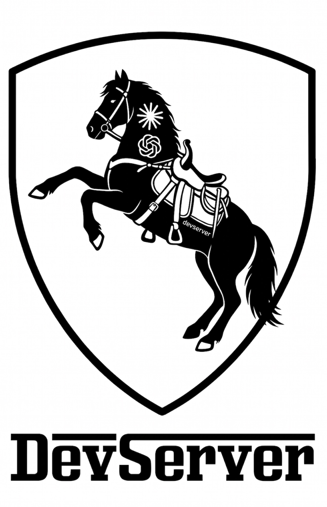
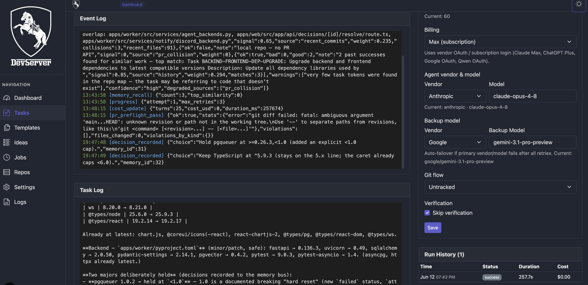
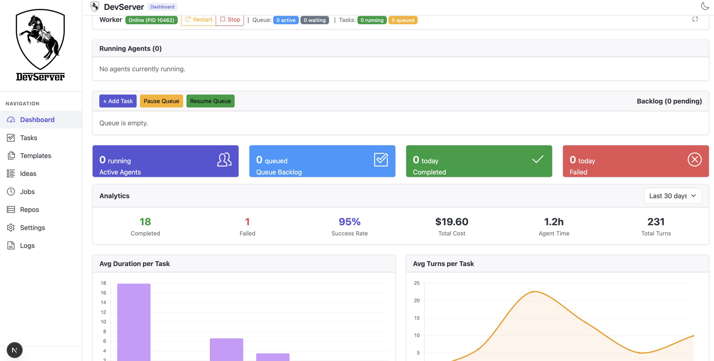
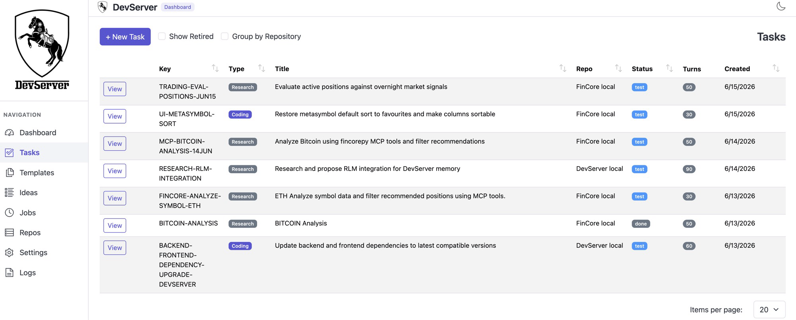
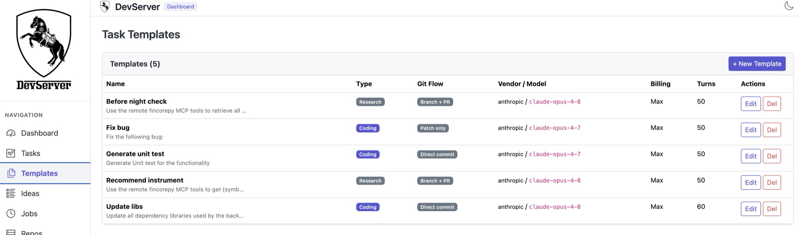
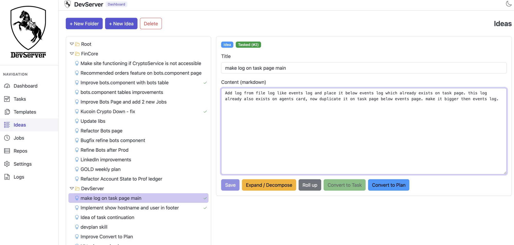
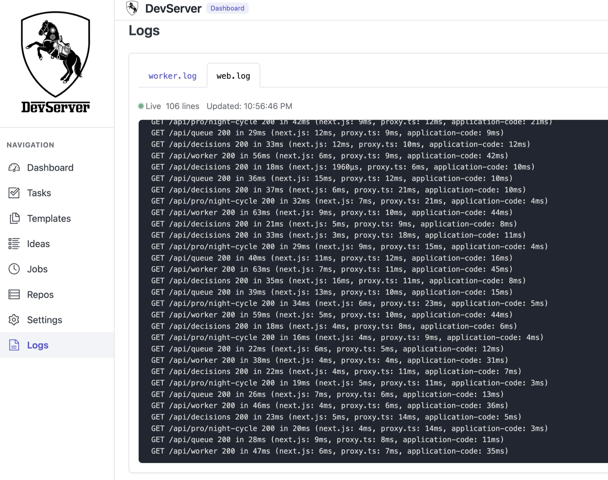
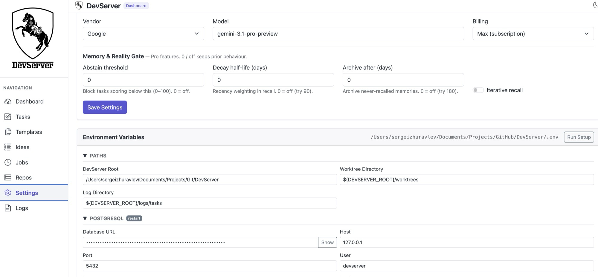
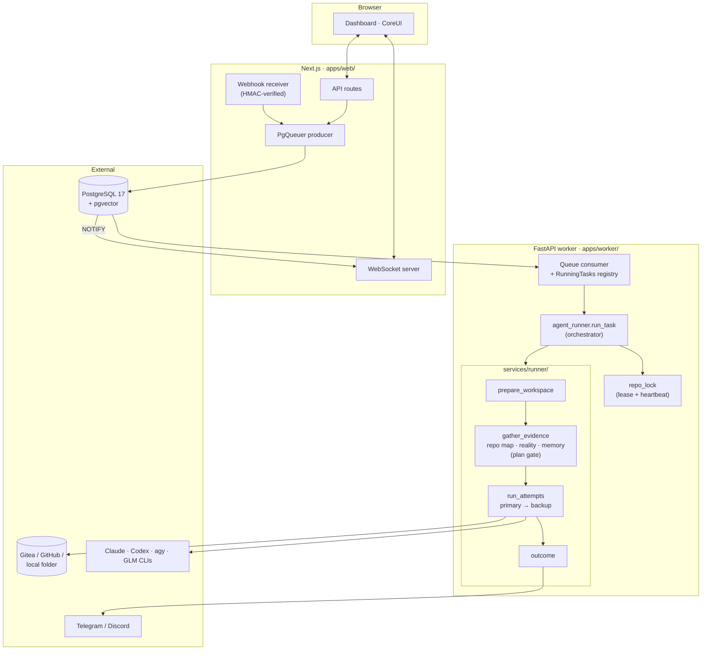
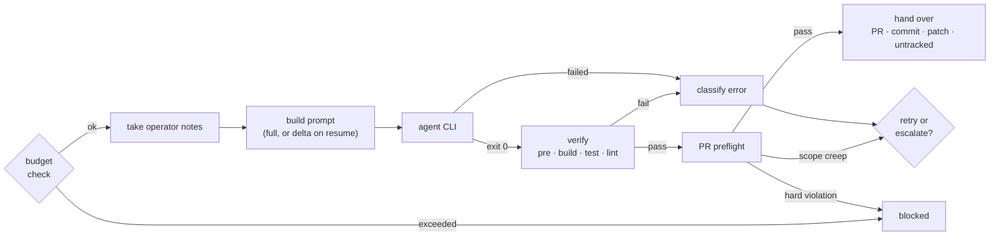

<div align="center">



# DevServer

### An autonomous coding pipeline for AI coding agents.

**Dispatches coding tasks → runs the agent in an isolated git worktree → verifies build/test/lint → opens a pull request on Gitea or GitHub. Or point it at any local git folder — no remote, no tokens, works with every git provider.**

[](LICENSE)
[](https://nextjs.org/)
[](https://react.dev/)
[](https://python.org/)
[](https://fastapi.tiangolo.com/)
[](https://postgresql.org/)
[](docker/)



[Why](#why-devserver) · [Engineering](#engineering-highlights) · [Features](#features) · [What's new](#whats-new-in-1018--the-showcase-refactor) · [Architecture](#architecture) · [Design Decisions](#design-decisions) · [Quick Start](#quick-start) · [Project Layout](#project-layout) · [Roadmap](#roadmap)

</div>

---

## 🐎 Three thoroughbreds. No saddle, no harness.


**Claude. Gemini. ChatGPT.** Three of the most powerful minds ever built — and on their own, that's exactly what they are: magnificent animals standing in a field. You copy-paste between chat tabs, babysit half-finished diffs, lose all context the second you switch models, and nothing actually *ships* while you watch.

Raw horsepower isn't speed. **Speed needs a harness.**

## 🏇 Saddle up. This is DevServer.


DevServer is the **full harness for your AI providers** — saddle, reins, and stirrups for Claude, Gemini, *and* ChatGPT, all at once. Hand it a task and it dispatches the right agent into an isolated git worktree, verifies build/test/lint, and opens the pull request for you. Rate-limited? It fails over to another vendor mid-stride. Drifting off course? Reality checks, plan gates, and per-repo memory keep it on the track.

One platform. Every model. **Ride your AI at Ferrari style — and Ferrari speed.**

➡️ Point it at any repo and let it run → **[Quick Start](#quick-start)**

---

## Why DevServer?

Most autonomous coding agents ship as a closed SaaS, a VS Code extension, or a CLI glued to GitHub. DevServer is the opposite: a **self-hosted harness** that runs the coding-agent CLIs you already use (Claude Code, Codex, Antigravity, GLM) as supervised workers — with a queue, a verifier, guardrails, an audit trail and a dashboard around them.

- **Multi-vendor agent backends.** Claude (Anthropic), Gemini via Google's Antigravity CLI, Codex (OpenAI) and GLM (Zhipu), behind one `AgentBackend` interface. Switch per task; fail over to a backup vendor or model automatically when retries run out.
- **Pay by API key or by subscription.** Per-task billing mode: `api` (metered key) or `max` (Claude Max, ChatGPT Plus, Google AI Pro/Ultra through the CLI's own login).
- **Evidence before action.** A repo map, a 0–100 reality score and hybrid memory recall go into the prompt before the agent writes a line; an opt-in abstain gate blocks tasks the code base cannot support.
- **Error-class-aware retries.** Failures are classified by 20+ rules and the next attempt gets a targeted hint. The same error twice escalates instead of burning retries.
- **Guardrails without extra LLM calls.** Budget circuit breaker, deterministic PR preflight (secrets, forbidden and oversize files, author), side-effect approval gate.
- **Human in the loop where it matters.** Plan approval for interactive tasks, operator notes delivered to a running agent, real cancellation that kills the agent process.
- **Full live observability.** Every step is a typed event: PostgreSQL `NOTIFY` → WebSocket → dashboard, plus opt-in OpenTelemetry export.

All of the above are real, tested code paths. The rest of this README shows how they are built.

## Engineering highlights

DevServer is also a showcase of how to build an **agent harness** that stays readable as it grows. The priorities, in order: **readability → reviewability → correctness → features**. Performance is deliberately not a goal.

| Concern | How it is solved | Where |
|---|---|---|
| A 1,600-line `run_task` | A ~30-line `run_task` orchestrating small phase functions sharing one `TaskContext`; primary and backup models go through the *same* `run_attempts()` | [`agent_runner.py`](apps/worker/src/services/agent_runner.py), [`services/runner/`](apps/worker/src/services/runner/) |
| "Did the refactor change behaviour?" | Characterisation tests drive the real runner against real PostgreSQL, a temp git repo and a scripted fake agent subprocess | [`tests/runner/`](apps/worker/tests/runner/) |
| Cancel only relabelled the task | A `RunningTasks` registry cancels the `asyncio.Task`; `proc.run` kills the agent's whole process group; the runner always writes a terminal status | [`running_tasks.py`](apps/worker/src/services/running_tasks.py), [`proc.py`](apps/worker/src/services/proc.py), [`task_control.py`](apps/worker/src/services/task_control.py) |
| Locks that could be stolen or leak | Repo locks are **leases**: an owner, a short TTL and a heartbeat; release deletes only the caller's row; a busy repo re-queues the job instead of failing it | [`repo_lock.py`](apps/worker/src/services/repo_lock.py), [`queue_consumer.py`](apps/worker/src/services/queue_consumer.py) |
| Model IDs copied across Python and TypeScript | One typed registry (`ModelInfo`) served at `/internal/agent-registry`; the web app renders every picker from it | [`agent_backends.py`](apps/worker/src/services/agent_backends.py), [`agent-vendors.ts`](apps/web/src/lib/agent-vendors.ts) |
| Four hand-rolled retry loops | One `retry_async(fn, attempts=, backoff=Backoff(...), retry_on=)` | [`retry.py`](apps/worker/src/services/retry.py) |
| DB sessions pinned for an hour per task | Repository-style functions, one short session per unit of work; nothing holds a session across a subprocess | [`runner/store.py`](apps/worker/src/services/runner/store.py) |
| Hung git remotes | Every git call takes a required, per-operation timeout | [`git_ops.py`](apps/worker/src/services/git_ops.py) |

Tooling: `ruff` (lint + format, blocking), `pyright` basic (reported), `pytest` with real-database integration tests, Node's test runner for the web's pure modules. See [`docs/architecture.md`](docs/architecture.md) for the design walkthrough and [`docs/decisions.md`](docs/decisions.md) for the decision log.

## Features

### Dashboard — what's running, what's queued, what cost what

<a href="assets/dashboard.png"></a>

The landing page. Top: worker status bar with online/offline indicator, queue depth, and active/pending/running task counts. Middle: running agents list and queue control toolbar (Add Task, Pause Queue, Resume Queue). Below: colour-coded stat cards (running, queued, completed today, failed today). **Analytics** section with a summary row (completed, failed, success rate %, total cost, agent time, total turns) plus two governance KPIs neither competitor surfaces — **Cost / PR** (average LLM spend per pull request) and **Abstain Savings** (spend avoided on tasks the reality gate refused to start) — and Avg Duration per Task (bar) and Avg Turns per Task (line) charts, configurable from 7 to 90 days. Everything updates in real time over the WebSocket.

📂 [`apps/web/src/components/Dashboard.tsx`](apps/web/src/components/Dashboard.tsx) · [`apps/web/src/components/DashboardCharts.tsx`](apps/web/src/components/DashboardCharts.tsx)

---

### Tasks — the full backlog with status and priority

<a href="assets/tasks.png"></a>

The full task backlog. Columns: colour-coded priority badge, task key, title, repo, status badge, turns used, and created date. Filter by status (`pending` / `queued` / `running` / `verifying` / `test` / `failed` / `blocked` / `cancelled`), toggle retired tasks, and paginate with items-per-page selector. Each row links to the task detail view. The **+ New Task** button opens the creation form with an optional template picker. An **Import** button pulls Confluence pages straight into the backlog (see *Import from Confluence* below), and grid rows carry checkboxes for **bulk retire** — select any number of tasks across repo groups and retire them in one click.

A **Grid ⇄ Board** toggle switches the same data between the table and a **Pipeline Board** — a kanban projection with lifecycle-native lanes (**Queued / Active / Needs You / Shipped / Stalled**). Cards carry a vendor badge, priority flag, reality-score chip, and inline actions (Enqueue / Cancel / Continue); lanes transition live over the websocket with no polling, and filters cover repo / vendor / "needs you only". A **"Needs You"** count pill on the sidebar surfaces tasks awaiting a human decision.

📂 [`apps/web/src/app/tasks/page.tsx`](apps/web/src/app/tasks/page.tsx) · [`apps/web/src/components/TaskTable.tsx`](apps/web/src/components/TaskTable.tsx) · [`apps/web/src/components/PipelineBoard.tsx`](apps/web/src/components/PipelineBoard.tsx)

---

### Task Detail — events, runs, agent settings

<a href="assets/viewtask.png"></a>

The single most information-dense view in the product. From left:

- **Live event log** — every agent step (`repo_map_built`, `reality_signal`, `error_classified`, `pr_preflight_pass`, `rate_limit_backoff`, `vendor_failover`) as it streams in over PG `NOTIFY` → WebSocket.
- **Task log** — real-time tail of the per-task log file with run result, diff stats, and `git am`-ready output.
- **Agent settings sidebar** — per-task overrides for billing mode (API / Max subscription), vendor + model picker, backup vendor + model for auto-failover, git flow (Branch + PR / Direct commit / Patch only — Local Git repos offer Untracked changes / Patch only instead), verification toggle, and a Save button.
- **Plan card** (interactive tasks), **Patches panel** (patch-flow tasks) and **Task Notes** — see the sections below.

📂 [`apps/web/src/app/tasks/[id]/page.tsx`](apps/web/src/app/tasks/[id]/page.tsx) · [`apps/web/src/components/TaskDetail.tsx`](apps/web/src/components/TaskDetail.tsx)

---

### Task Templates — saved presets for repetitive work

<a href="assets/templates.png"></a>

Create reusable templates with pre-filled descriptions, acceptance criteria, agent vendor/model, git flow, billing mode, max turns, and all other agent settings. The template table shows name, git flow badge (Direct commit / Branch + PR), vendor/model, billing mode, and max turns at a glance. When creating a new task, pick a template from the dropdown and the form is pre-filled instantly.

📂 [`apps/web/src/app/templates/page.tsx`](apps/web/src/app/templates/page.tsx) · [`apps/web/src/components/TemplateList.tsx`](apps/web/src/components/TemplateList.tsx)

---

### Ideas — hierarchical brainstorm tree, convertible to tasks

<a href="assets/ideas.png"></a>

A lightweight brainstorm space. Folders contain other folders or **idea leaves** (markdown content). Reorganise the tree by **drag-and-drop** — drop an idea onto a folder (or the empty root area) to reparent it, with cycle-safe validation and optimistic updates. When an idea is ready, click *Convert to Task* and it lands in the tasks backlog with the description pre-populated. Idea → task linkage is preserved in the database. An **Import** button brings Confluence pages in as ideas.

📂 [`apps/web/src/app/ideas/page.tsx`](apps/web/src/app/ideas/page.tsx) · [`apps/web/src/components/IdeasView.tsx`](apps/web/src/components/IdeasView.tsx)

---

### Import from Confluence — pages become Tasks or Ideas

A shared **Import** dialog on the Tasks and Ideas pages pulls documentation straight out of Confluence: pick the source, search by text or raw CQL (with an optional Space filter), tick the pages you want, preview the converted Markdown, then map them to **Tasks** (choose repo, priority, optional auto-enqueue) or **Ideas** (lands at the tree root).

- **Cloud and Data Center/Server** are both supported — email + API token (Basic auth) for Cloud, Personal Access Token (Bearer) for DC; the `/wiki` suffix is added automatically for `*.atlassian.net`.
- **Global or per-repo credentials** — configure once in Settings (stored in `.env`, never in the database), or give a repo its own Confluence connection override.
- **Idempotent re-imports** — an `external_imports` ledger maps each page to its target; unchanged versions are skipped, changed ones update the existing task/idea in place. Never duplicated.
- **Storage-format → Markdown** conversion (headings, lists, code macros, tables, links) with zero new dependencies, and the framework is pluggable — Confluence is the first source adapter.

📂 [`apps/web/src/components/ImportModal.tsx`](apps/web/src/components/ImportModal.tsx) · [`apps/worker/src/services/import_sources/`](apps/worker/src/services/import_sources/)

---

### Logs — live tail of worker and web process output

<a href="assets/logs.png"></a>

A real-time log viewer with two tabs — `worker.log` and `web.log` — polled every 1.5 seconds. Lines are colour-coded by severity (ERROR red, WARNING yellow, INFO blue, DEBUG green). Auto-scrolls to the bottom; a jump-to-bottom button appears when you scroll up.

📂 [`apps/web/src/app/logs/page.tsx`](apps/web/src/app/logs/page.tsx) · [`apps/web/src/components/LogsView.tsx`](apps/web/src/components/LogsView.tsx)

---

### Settings — global queue, system LLM, and environment variables

<a href="assets/settings.png"></a>

A single-page control panel for the worker's global behaviour. **General** card: max concurrency (1–10), queue-paused and auto-enqueue toggles, Telegram notification toggle, the **System LLM** vendor + model picker (used by Fill Task and DevPlan), and a **Memory & Reality Gate** row (abstain threshold, memory decay half-life, archive window, iterative-recall toggle — all default to off so behaviour is unchanged until you opt in). **Environment Variables** card: live view of the `.env` file path, database connection details (host, port, user, database), and masked API keys with a Show/Hide toggle — plus a **Run Setup** button to re-run the interactive `.env` wizard. A **Confluence** card configures the global external-import connection (base URL, username/email, API token or PAT) with a one-click **Ping** connectivity test; values are written to `.env` and hot-reloaded into the running worker.

📂 [`apps/web/src/app/settings/page.tsx`](apps/web/src/app/settings/page.tsx) · [`apps/web/src/components/SettingsForm.tsx`](apps/web/src/components/SettingsForm.tsx)

---

### Repositories — Gitea, GitHub, or any local git folder

Three repository types, selected per repo:

- **Gitea / Forgejo** — clones over HTTPS with a per-repo or global token, opens PRs through the Gitea REST API.
- **GitHub** — same pipeline with GitHub-correct auth (`x-access-token` works for classic PATs, fine-grained PATs and App tokens alike) and the GitHub PR API. GitHub Enterprise Server is supported too.
- **Local Git** — defined by a **Local Root Folder** instead of a clone URL. DevServer runs git directly inside that folder: no clone, no worktree copy, no tokens, and — by hard guarantee — **no push, ever**.

Why Local Git matters: it makes DevServer **provider-agnostic**. Clone a repo from **GitHub, GitLab, Bitbucket, Azure DevOps, a private bare repo on a NAS — anything** — and point DevServer at the folder. Since all work happens against the local clone, there is no host API to integrate, no token to provision, and nothing ever leaves your machine. Two git flows fit this model:

- **Untracked changes** — the agent only edits files in your working tree. No branch, no commit, no push; you review the diff with your normal tools and commit it yourself.
- **Patch only** — the agent commits on a local `agent/…` branch (your original branch is restored afterwards) and the commits are exported as `.patch` files you can `git am` anywhere.

Safety guarantees for your folder: DevServer never hard-resets or cleans it, refuses to start a patch-flow task on a dirty working tree (so your own uncommitted work can never be swept into agent commits), and the agent is explicitly instructed to never touch remotes. Local repos show a turquoise **Local** badge on the Repos page.

📂 [`apps/worker/src/services/git_ops.py`](apps/worker/src/services/git_ops.py) · [`apps/web/src/components/RepoForm.tsx`](apps/web/src/components/RepoForm.tsx)

---

### Architecture diagram — instant module map, no LLM

Each repo on the Repos page has a **Diagram** button that opens a full-screen, scrollable **Mermaid** flowchart of the repo's module tree. It's generated deterministically from the same directory walk as the repo map (`build_mermaid`) — no LLM call, no token cost, regenerates instantly — so you get a current architecture picture for free, on demand.

📂 [`apps/worker/src/services/repo_map.py`](apps/worker/src/services/repo_map.py) (`build_mermaid`) · [`apps/web/src/components/RepoDiagramModal.tsx`](apps/web/src/components/RepoDiagramModal.tsx)

---

### Jobs — cron schedules that re-run tasks

A schedule binds a name + cron expression (`@hourly`, `@daily`, `every 30m`, `every 2h`, `HH:MM` UTC) to an **existing task**. On every fire the task is reset to pending and enqueued through the normal pipeline; a task that is already queued or running is left alone — no double-runs. Run history lands in the task's own runs/events, so there is nothing extra to monitor.

📂 [`apps/web/src/components/SchedulesPanel.tsx`](apps/web/src/components/SchedulesPanel.tsx) · [`apps/worker/src/services/scheduler.py`](apps/worker/src/services/scheduler.py)

---

### Ask Agent — an assistant that knows the product and the page you're on

A button in the bottom-right of every screen (or `⌘/Ctrl + K`) opens a chat drawer that runs on your configured **System LLM** — so it costs whatever that model costs, and nothing else. It always knows which page you're looking at, and on a task or repo page it knows *which* task or repo, so "why is this stuck?" is answered about that one.

It is grounded in a curated handbook shipped in the repo ([`docs/assistant/`](docs/assistant/)) rather than the model's memory of DevServer, so it explains the actual screens, statuses, git flows and settings this version has. Answers stream token by token.

A combobox in the drawer's toolbar picks the **model** for the next turn, from whatever your System LLM vendor offers — reach for a bigger model on a hard question, drop back to a cheap one for the rest. The vendor itself stays a Settings decision, since changing it also changes credentials and billing. Your choice is remembered.

It answers questions and says plainly when it cannot see something. It has no tools and no shell: it can explain, never act.

📂 [`apps/web/src/components/AskAgentPanel.tsx`](apps/web/src/components/AskAgentPanel.tsx) · [`apps/worker/src/routes/assistant.py`](apps/worker/src/routes/assistant.py) · [`apps/worker/src/services/assistant_kb.py`](apps/worker/src/services/assistant_kb.py)

### Agent guardrails — evidence, budget, and a deterministic preflight

Every coding task passes through three checks that need no extra LLM call:

- **Reality gate (lite).** Before the agent starts, DevServer scores the task 0–100 from two weighted signals that run in parallel: how many of the task's identifiers actually appear in the repo map, and whether the files it touches changed in the last 14 days. If a signal fails, its weight goes to the other one. The score, evidence and warnings are injected into the prompt. Set `reality_abstain_threshold` to block low-evidence tasks before any tokens are spent.
- **Budget circuit breaker.** `max_cost_usd` / `max_wall_seconds` on a task emit a `budget_warning` event at 80% and stop retries at 100%, marking the task `blocked`.
- **PR preflight.** Before anything is pushed, the diff is scanned for leaked secrets (API keys, tokens, private keys), forbidden files (`.env`, key files), files over 1 MB, and a wrong commit author. A failure marks the task `blocked` instead of opening a PR.

📂 [`reality_gate.py`](apps/worker/src/services/reality_gate.py) · [`pr_preflight.py`](apps/worker/src/services/pr_preflight.py) · [`secret_rules.py`](apps/worker/src/services/secret_rules.py) · [`budget.py`](apps/worker/src/services/budget.py)

### Memory — hybrid recall of past task experience

Every successful task is summarised into `agent_memory` with a local [fastembed](https://github.com/qdrant/fastembed) embedding (no cloud key). The next task on the same repo recalls the most relevant entries through two lanes: pgvector cosine similarity, and Postgres full-text search, which catches exact symbols, error strings and file paths. The two ranked lists are combined with **Reciprocal Rank Fusion** (k=60), and the top hits go into the prompt as "Prior Experience".

📂 [`apps/worker/src/services/memory.py`](apps/worker/src/services/memory.py) · [`apps/worker/src/services/embeddings.py`](apps/worker/src/services/embeddings.py)

### Plan Gate — approve the plan before any code is written

Set a task's mode to **interactive** and the agent first runs read-only with a small turn budget, answering with a structured plan: summary, steps, files to touch, risks. The task stops at a **Plan** card on its detail page. **Approve** and the plan is injected into the implementation prompt — and its `files_to_touch` becomes the PR-preflight allow-list, so the agent cannot quietly widen the scope it was approved for. **Reject**, or leave it unanswered for an hour (`plan_gate_timeout_seconds`), and the task is blocked. A planning run that edits files is refused.

📂 [`plan_gate.py`](apps/worker/src/services/plan_gate.py) · [`PlanCard.tsx`](apps/web/src/components/PlanCard.tsx)

### Task Notes — talk to a running agent

Post a note on a running task ("use the existing retry helper", "skip the docs"). The runner picks up unread notes at the start of the next attempt, adds them to that attempt's prompt and marks them read in the same SQL statement — so each note reaches the agent **exactly once**. Notes on a finished task are kept for the record and never replayed into a later run. Also available from Telegram as `/reply TASK-KEY <note>`.

📂 [`task_notes.py`](apps/worker/src/services/task_notes.py) · [`TaskNotesPanel.tsx`](apps/web/src/components/TaskNotesPanel.tsx)

### Patch Export — reviewable `.patch` files

Tasks using the **patch** git flow never push. When one succeeds, its commits are exported with `git format-patch` and listed in a **Patches** panel for download and `git am`. File names arrive from URLs, so they are validated twice — a strict name pattern, then a resolved-path containment check — and traversal attempts get a `400`.

📂 [`patch_export.py`](apps/worker/src/services/patch_export.py) · [`PatchesPanel.tsx`](apps/web/src/components/PatchesPanel.tsx)

### Webhook Triggers — turn external events into tasks

Create a trigger on the **Webhooks** page: a repo, an opaque URL token, a secret, and `{{json.path}}` templates for the title and description. `POST /api/webhooks/<token>` must carry `X-DevServer-Signature: sha256=<hmac>`; it is verified with HMAC-SHA256 and a constant-time comparison. A valid call creates and enqueues a task; a missing or wrong signature gets `401`, a disabled trigger `404`. A trigger without a secret cannot be created.

📂 [`apps/web/src/lib/webhooks/`](apps/web/src/lib/webhooks/) · [`apps/web/src/app/webhooks/`](apps/web/src/app/webhooks/)

### MCP server — drive DevServer from Claude Code, Codex or Gemini

A small stdio MCP server lets an interactive coding CLI create a task in the current repo with a chosen vendor and model, start it on the worker, poll its status and read its output (`task_options`, `task_create`, `task_run`, `task_list`, `task_status`, `task_output`, `task_cancel`). Setup for each CLI is in its README.

📂 [`apps/mcp-memory/`](apps/mcp-memory/README.md) · design notes in [`docs/`](docs/)

---

## What's new in 1.0.18 — the showcase refactor

This release is about the code, not the feature count. Full notes: [`docs/release-notes/1.0.18.md`](docs/release-notes/1.0.18.md).

- **The runner, decomposed.** `run_task` went from ~1,600 lines with a copy-pasted backup-model loop to a short orchestrator over [`services/runner/`](apps/worker/src/services/runner/): `context`, `store`, `phases`, `attempt`, `failures`, `preflight`, `delivery`, `outcome`, `agent_call`. The terminal status, daily stats and notification are written in exactly one place.
- **The edition indirection is gone.** The `FreeHooks` layer of kwargs-bag stubs (which, among other things, made `mode=interactive` a silent no-op) was deleted; services are called directly.
- **Correctness fixes**, each with a regression test: real cancellation, short-lived DB sessions, lock leases with heartbeat, requeue on lock contention, stale recovery that re-enqueues and frees only its own lock, a timeout on every git call, a preflight hard failure that is no longer overwritten by `failed` and sent to the backup model, a system-LLM tuple-unpack crash in the side-effect gate, a task-log path traversal.
- **Four demo features**: Plan Gate, Task Notes, Patch Export, Webhook Triggers.
- **Model registry**: typed `ModelInfo` entries, one source for Python and the web. Added **Claude Haiku 5.5** and **Gemini 4 Argon** (High / Medium / Low). Models two or more generations old are hidden from pickers but still accepted.
- **Tooling**: ruff (E, F, I, B, UP, SIM, RUF, ASYNC), pyright basic, 90+ worker tests including end-to-end runs against PostgreSQL.

---

## Architecture



Three small services, one PostgreSQL. No Redis, no RabbitMQ, no Celery — **PgQueuer** uses the same database everything else lives in.

### One attempt



Every exit of an attempt is a `Verdict` (`SUCCEEDED`, `RETRY`, `ESCALATE`, `BLOCKED`, `BUDGET_EXCEEDED`, `SUSPENDED`); the attempt loop and [`outcome.record`](apps/worker/src/services/runner/outcome.py) are a `match` over that enum. A walkthrough of every module is in [`docs/architecture.md`](docs/architecture.md).

## Design Decisions

### 1. Multi-vendor agent backends

DevServer isn't locked to one AI provider. The `AgentBackend` abstraction covers four vendors out of the box:

| Vendor | CLI Binary | Picker models (default first) | Source of the IDs |
|---|---|---|---|
| `anthropic` | `claude` | **Claude Sonnet 5.5**, Opus 5.5, Fable 5.1, **Haiku 5.5**, Sonnet 5, Opus 5, Fable 5 | Anthropic models page |
| `google` | `agy` | **Gemini 3.1 Pro** (High/Low), **Gemini 4 Argon** (High/Medium/Low), Gemini 3.8 Flash | `agy models` (Antigravity CLI 1.4.9) |
| `openai` | `codex` | **GPT-6 Astra**, GPT-5.6 Sol / Terra / Luna, GPT-5.5 | model catalogue in codex-cli 0.155.1 |
| `glm` | `claude` | **GLM-5.3**, 5.2, 5.1, 5 Turbo, 5 — the Claude CLI against Zhipu's Anthropic-compatible API | Zhipu `/models` API |

Older models (Claude 4.x, Gemini 3.6/3.7 Flash, GPT-5.2–5.4, GLM-4.x) are marked `deprecated`: hidden from the pickers, still accepted where a task or repo already stores them.

Each task carries `agent_vendor`, `claude_model`, and `claude_mode` (billing mode: `api` or `max`). The worker dispatches to the right backend automatically. Adding a new vendor is one `AgentBackend` subclass, a `register_backend()` call and its models in `VENDOR_MODELS`.

> **Note — Google migrated to the Antigravity CLI.** Google retired the Gemini CLI on 2026-06-18 (`gemini` commands now return *410 Gone*). The Google backend now drives Google's replacement, the **Antigravity CLI** (`agy`), reusing the same Gemini API key and Google AI Pro/Ultra subscription. Install with `curl -fsSL https://antigravity.google/cli/install.sh | bash`.

**Billing modes are vendor-agnostic.** `api` inherits the vendor's API-key env var; `max` strips it so the CLI uses its own subscription login. That means you can run a task on **Claude Max**, **ChatGPT Plus** (`codex login`), or **Google AI Pro / Ultra** without per-token metering. For Google, sign in once with `agy` (the Google account holding the subscription), set the task's billing to **Max**, and pick `gemini-3.1-pro-high`. In `api` mode the worker reuses your existing `GEMINI_API_KEY` (bridged to `ANTIGRAVITY_API_KEY`).

📂 [`apps/worker/src/services/agent_backends.py`](apps/worker/src/services/agent_backends.py)

### 2. Auto-failover between vendors

Each task can have a `backup_vendor` and `backup_model`. When the primary vendor exhausts all retries (including rate-limit backoff), the runner automatically switches:

- Resets to the backup vendor's `AgentBackend`
- Clears the session (sessions can't be resumed cross-vendor)
- Commits any in-progress work
- Runs a fresh retry loop with the backup vendor/model

This means a rate-limited Anthropic task can transparently continue on GLM or Google — no manual intervention.

### 3. Error-class-aware retries, not blanket re-runs

The naive "append stderr, retry" loop costs a full Claude session per attempt. DevServer runs verifier/agent output through 20 regex rules spanning Python, TypeScript / Node, C# / .NET, Rust, Go, Java, Git, and shell. Each matched rule produces a structured `ErrorClass(key, hint, severity)`:

- **`recoverable`** errors (import error, test failure, TS compile error) inject a surgical remediation hint into the next retry's prompt.
- **`hard`** errors (merge conflict, `git nothing to commit`, `command not found`, permission denied) escalate immediately — no more retries.
- A `recoverable` class that repeats across two attempts escalates too, on the theory that "same error twice" means the agent is stuck.

📂 [`apps/worker/src/services/error_classifier.py`](apps/worker/src/services/error_classifier.py)

### 4. Multi-language repo map

Before any agent subprocess starts, the worker builds a regex-based symbol index covering classes, functions, and types across 11 languages. This ~4 KB block in the prompt eliminates "file not found" retries by giving the agent an accurate picture of what exists and where.

📂 [`apps/worker/src/services/repo_map.py`](apps/worker/src/services/repo_map.py)

### 5. Rate-limit hardening

Concurrent tasks hitting vendor rate limits are handled at two levels:

1. **Per-subprocess 429 backoff** — a vendor 429 is retried by `retry_async` with a `Backoff((30, 60, 120), jitter=10)` policy without consuming a task-level attempt.
2. **Minimal retry prompts** — resumed sessions receive only the error/remediation block, not the full context again, cutting per-retry token usage by ~50%.

📂 [`runner/agent_call.py`](apps/worker/src/services/runner/agent_call.py) · [`runner/prompt.py`](apps/worker/src/services/runner/prompt.py)

### 6. Governance-grade OpenTelemetry (opt-in)

DevServer can export its entire task pipeline as OpenTelemetry spans to any OTLP collector (Langfuse, Grafana Tempo, Datadog, Jaeger). It's wired at the **single `store.emit_event` chokepoint** every task event already flows through, so one wrapper covers all ~16 event types: a per-task root span is opened at task start, each event becomes a span event, and the run closes at the terminal status. Beyond the standard GenAI attributes (`gen_ai.system`, `gen_ai.request.model`, `gen_ai.usage.*`), spans carry **DevServer-only governance attributes** — `devserver.reality_score`, `devserver.budget.cost_usd` / `.wall_seconds`, `devserver.preflight.secret_hits`, `devserver.error_class`, `devserver.vendor_failover`, `devserver.final_status` — the richest agent telemetry, in your own stack.

It is **fully opt-in and zero-overhead**: a no-op unless `OTEL_EXPORTER_OTLP_ENDPOINT` is set *and* the optional `otel` extra is installed (`uv sync --extra otel`), so deployments that don't use it pay nothing.

📂 [`apps/worker/src/services/telemetry.py`](apps/worker/src/services/telemetry.py)

### 7. Patterns, named

The code uses a handful of well-known patterns, each where it removes a real problem rather than for its own sake:

| Pattern | Where | Why it is there |
|---|---|---|
| **Strategy** | `AgentBackend` subclasses in [`agent_backends.py`](apps/worker/src/services/agent_backends.py) | Each vendor CLI differs in argv, env, output and 429 shape; the runner never branches on vendor. |
| **Registry** | `register_backend()`, `VENDOR_MODELS`, `RunningTasks` | One lookup point: tests plug a fake backend in; cancel finds the live run. |
| **Context object** | `TaskContext` in [`runner/context.py`](apps/worker/src/services/runner/context.py) | Phases share state explicitly instead of through 30 local variables in one function. |
| **Parameter object** | `AgentInvocation` in [`runner/agent_call.py`](apps/worker/src/services/runner/agent_call.py) | Eleven arguments become one immutable, named value. |
| **Result type / state machine** | `Verdict` + `AttemptResult` in [`runner/results.py`](apps/worker/src/services/runner/results.py) | Control flow is data: the loop and the outcome are `match` statements, not `break`/`continue` webs. |
| **Repository functions / unit of work** | [`runner/store.py`](apps/worker/src/services/runner/store.py), [`repo_lock.py`](apps/worker/src/services/repo_lock.py) | SQL stays out of orchestration; every write is one short transaction. |
| **Lease with heartbeat** | [`repo_lock.hold()`](apps/worker/src/services/repo_lock.py) | A crashed worker's lock expires; a live one is never mistaken for stale. |
| **Circuit breaker** | [`budget.py`](apps/worker/src/services/budget.py) | A runaway retry loop stops at a cost or wall-clock cap. |
| **Retry policy object** | `Backoff` + `retry_async` in [`retry.py`](apps/worker/src/services/retry.py) | The schedule is data; the loop is written once. |
| **Fan-out dispatcher (observer)** | [`notify/`](apps/worker/src/services/notify/) | Telegram, Discord and push backends receive typed events; a failing channel never blocks another. |
| **Adapter** | [`import_sources/`](apps/worker/src/services/import_sources/) | Confluence is one pluggable source behind a common interface. |
| **Dependency injection** | webhook firing in [`apps/web/src/lib/webhooks/`](apps/web/src/lib/webhooks/) | The HTTP handler is tested with a fake data-access object, no database. |

## Tech Stack

| Layer | Choice | Why |
|---|---|---|
| **Frontend** | Next.js 15 App Router · React 19 · CoreUI Pro | Server components for task pages, client components for real-time panels. |
| **Backend worker** | Python 3.14 · FastAPI · SQLAlchemy 2.0 async · asyncpg | Async from top to bottom — every subprocess, DB call, and agent invocation is non-blocking. |
| **Job queue** | [PgQueuer](https://github.com/janbjorge/pgqueuer) | PostgreSQL-native queue. No Redis, no RabbitMQ — one fewer service to monitor. |
| **Database** | PostgreSQL 17 | Relational truth + queue + real-time notifications in one store. |
| **Real-time** | `LISTEN/NOTIFY` → WebSocket | Zero-dependency pub/sub. Dashboard updates arrive within ~100 ms. |
| **AI engines** | Claude, Gemini, Codex, GLM CLIs | DevServer *orchestrates* existing CLIs instead of reimplementing agent logic. |
| **Embeddings** | `fastembed` (local, ONNX/CPU) | Local semantic embeddings for memory recall — no cloud API, no key. Default `BAAI/bge-base-en-v1.5` (768-dim), override via `EMBEDDING_MODEL`. |
| **Git platform** | Gitea / Forgejo / GitHub / Local Git | Gitea and GitHub get PRs via their REST APIs; Local Git repos work on a plain local clone — any provider, no API, no tokens. |
| **Notifications** | Telegram Bot API | Basic task lifecycle alerts. |
| **Charts** | Chart.js + react-chartjs-2 | Lightweight, no-frills analytics visualizations. |
| **Package mgmt** | `uv` (Python) · `npm` (Node) | Fast, cacheable, boring. |

## Quick Start

### Prerequisites

- Node.js >= 22 LTS
- Python >= 3.14
- PostgreSQL >= 16
- At least one agent CLI installed and authenticated (e.g. `claude login`)
- `uv` for Python dependency management — [install guide](https://docs.astral.sh/uv/)
- A Gitea (or Forgejo) instance with a personal access token — or skip the git host entirely and use a **Local Git** repo (any local clone, no token needed)

### Local setup (host processes)

```bash
git clone https://github.com/<YOUR_GITHUB_HANDLE>/DevServer.git
cd DevServer
cp config/.env.example .env
# edit .env — fill in PGPASSWORD, GITEA_TOKEN, TELEGRAM_*, ANTHROPIC_API_KEY

./scripts/migrate.sh          # runs all SQL migrations
./scripts/start.sh --dev      # starts worker + web in dev mode
```

The dashboard is now at **http://localhost:3200** (configurable via `WEB_PORT` in `.env`).

> **On Windows?** Use the PowerShell scripts (`scripts\setup-local.ps1`,
> `scripts\start.ps1`) instead of the `.sh` ones — see [Windows](#windows).

### Upgrading an existing install

The whole schema lives in one idempotent migration, so upgrading an
existing database is just:

```bash
./scripts/migrate.sh   # safe to re-run; only applies what's missing
```

This adds the latest memory tables/columns and reshapes the
`agent_memory.embedding` column to the local-embedding dimension (768).
Backfill embeddings with the local model afterwards (the reshape drops the
old vectors):

```bash
cd apps/worker && uv run python scripts/reembed_memory.py
```

`fastembed` is a worker dependency; the embedding model downloads on first
use (the Docker image pre-bakes it). No embedding API key is required.

### Docker (recommended for production)

Use the lifecycle scripts — they read the repo-root `.env`, select the right
compose file/topology, and enable the bundled-database profile for you:

```bash
cp config/.env.example .env
# edit .env — minimum: PGPASSWORD, ANTHROPIC_API_KEY

./scripts/build.sh --docker
./scripts/start.sh --docker
```

The bundled `pgvector/pgvector:pg17` database runs under a compose **profile**
(`bundled-db`) so it can be skipped for Host-OS / External database modes. If
you invoke `docker compose` directly instead of the scripts, you must therefore
(a) pass `--profile bundled-db` to start the bundled DB, and (b) make the
repo-root `.env` visible to compose (the scripts `source` it; raw compose reads
only a `.env` in the current dir), e.g.:

```bash
cd docker
set -a && . ../.env && set +a            # export root .env for ${VAR} interpolation
docker compose --profile bundled-db up -d --build
```

This runs out of the box on Linux, macOS, and Windows.

**Two topologies — where do the agent CLIs run?** The worker shells out to a
vendor CLI (`claude` / `agy` / `codex` — GLM also uses `claude`) for every
task, and *where the worker runs* decides where those CLIs run:

| Topology | Compose file | Agent CLIs run… | Auth |
|---|---|---|---|
| **All-in-Docker** (default) | `docker-compose.yml` | inside the worker container (baked into the image) | API keys via `.env`; for `max` subscription mode, mount your host `~/.claude` (see below) |
| **Worker on host** | `docker-compose.host-worker.yml` | as host processes | your existing host logins (`claude login`, `codex login`, `agy` Google OAuth, GLM key) — nothing to install or mount |

Pick **worker-on-host** if you want the agents to use the subscription logins
already set up on your machine; pick **all-in-Docker** for a single portable
stack. Both are documented below.

**One image per tier.** The `worker` and `web` containers run separate tags —
`devserver:worker-latest` and `devserver:web-latest` — built from the one
`docker/Dockerfile` with `--target worker` / `--target web`. Each image carries
its own start command and health probe, so nothing picks a role at runtime.
Keep the pair on one version — build them together from a single commit.

**You build these images yourself.** DevServer publishes nothing to a container
registry, so the tags above are plain local names and there is no `docker
compose pull` path. Set `DEVSERVER_IMAGE` in `.env` if you want to tag and push
them to a registry of your own. Both services declare `image:` *and* `build:`,
which means:

```bash
docker compose up -d --build      # always rebuild (what the scripts do)
docker compose up -d              # build only if the image is absent locally
docker compose up -d --no-build   # run whatever is already tagged locally
```

Everything is built from one `docker/Dockerfile`; pick an artifact with
`--target`:

| Target | What | Used by |
|---|---|---|
| `web` | dashboard only, no Python/agent CLIs (~336 MB) | every topology, including `docker-compose.host-worker.yml` |
| `worker` | agent tier only | `docker-compose.yml` |
| `pydeps` | Python dependency stage, for iterating on the worker's deps | nothing — a build-time convenience |

#### Linux / macOS — host PostgreSQL (recommended)

If your host already runs PostgreSQL on port 5432, skip the bundled DB
with the host-DB override:

```bash
# If you previously ran the bundled-DB stack, tear it down first
docker compose down

docker compose -f docker-compose.yml -f docker-compose.host-db.yml up -d --build
```

On Docker Desktop (macOS) `host.docker.internal` is built in; on Linux
it is mapped through the compose override via `host-gateway`.

**Linux host Postgres prerequisites** (one-time):

1. `postgresql.conf` — add the docker bridge gateway to `listen_addresses`
   (check yours with `ip addr show docker0`, default is `172.17.0.1`):
   ```
   listen_addresses = 'localhost,172.17.0.1'
   ```
2. `pg_hba.conf` — allow the docker bridge subnet:
   ```
   host    devserver    devserver    172.16.0.0/12    scram-sha-256
   ```
3. `sudo systemctl reload postgresql` (listen_addresses needs a full
   restart: `sudo systemctl restart postgresql`).

**macOS host Postgres prerequisites** (one-time, Homebrew install):

1. `postgresql.conf` (usually `/opt/homebrew/var/postgresql@17/postgresql.conf`):
   ```
   listen_addresses = '*'
   ```
2. `pg_hba.conf` — allow the Docker Desktop VM subnet:
   ```
   host    devserver    devserver    192.168.65.0/24    scram-sha-256
   host    devserver    devserver    127.0.0.1/32       scram-sha-256
   ```
3. `brew services restart postgresql@17`.

Make sure the `vector` extension is installed on the host Postgres — on
macOS: `brew install pgvector` then `CREATE EXTENSION IF NOT EXISTS vector;`
in the `devserver` database.

#### Worker on host (run AI providers from your host OS)

Use this when you want the agents to run on your machine with the
subscription logins you already set up (`claude login`, `codex login`, the
`agy` Google OAuth, GLM key) instead of in a container. Postgres + the web
dashboard stay in Docker; only the Python worker runs natively.

```bash
# 1. DB + web in Docker (no worker container)
cd docker
docker compose -f docker-compose.host-worker.yml up -d --build

# 2. Worker on the host (new terminal, repo root)
cd apps/worker
cp ../../config/.env.example .env     # already host-shaped — then edit it
uv run uvicorn src.main:app --host 0.0.0.0 --port 8000
```

How the boundary is bridged (handled by the compose file):

- **web → worker**: the containerised dashboard reaches the host worker at
  `host.docker.internal:8000` (`WORKER_URL`). Built in on Docker Desktop;
  mapped via `host-gateway` for Linux.
- **worker → DB**: the DB port is published, so the host worker connects on
  `localhost:5432`.
- **logs**: web bind-mounts `<repo>/logs`, so the dashboard `/logs` viewer
  reads the host worker's log files.

Two `.env` values must match this layout:

- `DATABASE_URL` must point at `127.0.0.1:5432` (the published DB port) — the
  `postgres` service name only resolves *inside* Docker.
- `DEVSERVER_ROOT` must be the repo root so `LOG_DIR=${DEVSERVER_ROOT}/logs/tasks`
  lines up with the log dir web mounts.

In this mode the worker is not root, so the Claude/GLM
`--dangerously-skip-permissions` root restriction never triggers, and no agent
CLIs are installed into any image.

**Lifecycle scripts default to this topology.** `./scripts/build.sh --docker`,
`start.sh --docker`, `restart.sh --docker`, and `stop.sh --docker` all use
`docker-compose.host-worker.yml` and manage the host worker for you (build its
venv, start/stop the process). To run the all-in-Docker stack via the scripts
instead, set `DEVSERVER_COMPOSE=all-in-docker`:

```bash
DEVSERVER_COMPOSE=all-in-docker ./scripts/start.sh --docker
```

**Choosing the database (Settings → Database, or the Setup wizard).** In a
Docker deployment the Database card offers three options — **Docker PostgreSQL
(bundled)**, **Host OS PostgreSQL**, or **External host / credentials** (a
host build offers just *local default* vs *custom host/creds*). The card writes
the connection to `.env` and, for the non-bundled options, sets
`DEVSERVER_HOST_DB=1` plus the container-perspective `PGHOST_CONTAINER` /
`PGPORT_CONTAINER` so the web (and, in all-in-Docker, worker) **containers**
reach the right database — not just the host worker. The bundled `postgres`
container lives behind a `bundled-db` compose profile, so picking Host-OS /
External skips it entirely. A worker/web restart applies the change.

#### Max subscription (Claude OAuth) inside Docker

For the **all-in-Docker** topology, `max` (subscription) mode needs the OAuth
login from `claude login` — which lives in your host home dir. Run
`claude login` on the host once, then mount the config dir read-only by
uncommenting this line under the `worker` service in `docker-compose.yml`:

```yaml
    # - ${CLAUDE_CONFIG_DIR:-${HOME}/.claude}:/home/devserver/.claude:ro
```

The container runs as the unprivileged `devserver` user (uid 10001), so the
mount target is `/home/devserver/.claude` — the CLI reads `$HOME`.

Leave `ANTHROPIC_API_KEY` empty in `.env` so the CLI falls back to the mounted
login. (The worker-on-host topology above needs none of this — it uses your
host login directly.)

> **Windows:** `${HOME}` is not set for `docker compose` on native Windows, so
> the default above resolves to an invalid path. Set `CLAUDE_CONFIG_DIR` in
> `.env` to your host config dir using forward slashes —
> `CLAUDE_CONFIG_DIR=C:/Users/<you>/.claude` — before uncommenting the mount.

### Windows

Windows is a first-class target. Every `scripts/*.sh` lifecycle script has a
PowerShell twin (`scripts/*.ps1`), so you can run DevServer **natively** (host
processes, no WSL or Docker required) or under **Docker Desktop** — your pick.
Use **PowerShell** (not CMD) for everything below.

> If a script is blocked by the execution policy, allow it for the current
> session only: `Set-ExecutionPolicy -Scope Process -ExecutionPolicy Bypass`.

#### Option A — Native (PowerShell, recommended for development)

Prerequisites: **Node.js 22+**, **Python 3.14+**, **PostgreSQL 16+**, **uv**
([install](https://docs.astral.sh/uv/)), and at least one agent CLI
(e.g. `npm install -g @anthropic-ai/claude-code` then `claude login`).

```powershell
git clone https://github.com/<YOUR_GITHUB_HANDLE>/DevServer.git
cd DevServer

.\scripts\setup-local.ps1     # 1st run: copies config\.env.example -> .env, then stops
notepad .env                  #          fill in PGPASSWORD and ANTHROPIC_API_KEY (minimum)
.\scripts\setup-local.ps1     # 2nd run: bootstraps the DB role+db, runs migrations, installs deps

.\scripts\start.ps1           # start worker + web (dev mode, hot reload)
```

Open **http://localhost:3200**. `setup-local.ps1` creates the `devserver`
PostgreSQL role and database for you on a fresh host — if your superuser isn't
passwordless, set `PGSUPERUSER` / `PGSUPERPASSWORD` in `.env` or enter the
superuser password when prompted.

Day-to-day commands (all accept `-Dev` (default), `-Prod`, or `-Docker`):

```powershell
.\scripts\start.ps1 -Prod     # production build (next build + node server.js)
.\scripts\stop.ps1            # stop host processes and free the ports
.\scripts\restart.ps1 -Prod   # tear everything down and restart cleanly in a mode
.\scripts\build.ps1 -Prod     # build only (no start)
```

Logs stream to `logs\worker.log` and `logs\web.log`
(`Get-Content logs\worker.log -Wait` to tail).

#### Option B — Docker Desktop

1. Install [Docker Desktop for Windows](https://www.docker.com/products/docker-desktop/)
   with the WSL 2 backend, and clone the repo to a path with no spaces.
2. Create and edit `.env` at the repo root:
   ```powershell
   Copy-Item config\.env.example .env
   notepad .env     # set PGPASSWORD and ANTHROPIC_API_KEY at minimum
   ```
3. Build and start with the lifecycle scripts (they pick the compose
   files/profiles and manage the host worker for you):
   ```powershell
   .\scripts\start.ps1 -Docker
   ```
4. Open **http://localhost:3200**. Stop with `.\scripts\stop.ps1 -Docker`.

**Claude Max (subscription) mode on Windows.** To use `max` billing instead of
an API key, run `claude login` on the host once. In **native** mode it just
works (the CLI uses your host login). In **Docker** mode set `CLAUDE_CONFIG_DIR`
in `.env` to your host config dir with forward slashes
(`CLAUDE_CONFIG_DIR=C:/Users/<you>/.claude`) and uncomment the `claude_auth`
mount in `docker-compose.yml` — the `${HOME}/.claude` default that works on
macOS/Linux does **not** resolve for `docker compose` on native Windows, so
`CLAUDE_CONFIG_DIR` is required there.

## Backup & Restore

DevServer includes scripts for full-system backup and restore:

```bash
# Backup — creates a timestamped archive in backups/
bash scripts/devserver-backup.sh

# Restore from archive
bash scripts/devserver-restore.sh backups/devserver-backup-YYYYMMDD-HHMMSS.tar.gz
```

Backups include: PostgreSQL dump, settings JSON, `.env`, worktrees, and logs.
Supports both local and Docker modes automatically.

## Project Layout

```
apps/
  web/                                → Next.js frontend, API routes, PgQueuer producer, WebSocket server
    src/components/                   → Dashboard, TaskDetail (+ PlanCard, PatchesPanel, TaskNotesPanel), forms
    src/lib/agent-vendors.ts          → Model registry client (fetched from the worker, never hand-copied)
    src/lib/webhooks/                 → Template rendering, HMAC verification, trigger firing (+ tests)
    src/app/api/                      → Tasks, templates, analytics, settings, import, webhooks
    src/app/webhooks/                 → Webhook trigger admin page
  mcp-memory/                         → stdio MCP server — task control for coding CLIs (devserver-mcp)
  worker/                             → Python FastAPI worker + PgQueuer consumer
    src/services/
      agent_runner.py                 → run_task: the orchestrator
      runner/                         → the run, phase by phase
        context.py                    →   TaskSpec / RepoSpec snapshots + TaskContext
        store.py                      →   short-session DB operations (events, runs, stats)
        phases.py                     →   prepare → evidence → attempts (primary, backup) → finalise
        attempt.py                    →   one attempt: budget → agent → verify → preflight → handover
        failures.py, results.py       →   retry / escalate decisions and the Verdict vocabulary
        evidence.py, prompt.py        →   repo map, reality gate, memory recall; the prompt builder
        preflight.py, delivery.py     →   PR preflight bookkeeping; branch / commit / patch handover
        outcome.py                    →   terminal status, daily stats, notification — written once
        agent_call.py, task_log.py    →   one vendor CLI invocation; the per-task log file
      agent_backends.py               → Vendor strategies + the typed model registry
      plan_gate.py                    → Plan Gate (interactive mode)
      task_notes.py                   → Task Notes (operator → running agent)
      patch_export.py                 → Patch Export (format-patch + traversal guard)
      repo_lock.py                    → Repo lock leases with heartbeat
      running_tasks.py, task_control.py → Cancellation: registry of live runs + cancel/continue
      queue_consumer.py               → Job execution, requeue on a busy repo
      retry.py, budget.py             → Retry policy; budget circuit breaker
      system_llm.py                   → The one reader of the system-LLM settings
      reality_gate.py, pr_preflight.py, secret_rules.py → Guardrails
      error_classifier.py, verifier.py, repo_map.py, memory.py, git_ops.py, proc.py
    src/routes/                       → tasks, task_actions, task_artifacts, repos, system, generation, registry, assistant
    tests/runner/                     → Characterisation + integration tests (real PostgreSQL, fake agent subprocess)
    tests/unit/                       → Pure unit tests
docs/                                 → architecture.md (design walkthrough), decisions.md (decision log)
database/migrations/                  → Idempotent SQL schema
config/.env.example                   → Sanitised environment template
docker/                               → One Dockerfile (--target web|worker|pydeps) + compose files
scripts/                              → build / start / stop / migrate / backup / restore helpers
```

## Development

```bash
cd apps/worker
uv sync
uv run ruff check . && uv run ruff format --check .   # blocking
uv run pyright                                         # basic mode, reported
uv run pytest                                          # needs a local PostgreSQL for tests/runner
```

The integration tests create and migrate `devserver_test` on first use (override with `DEVSERVER_TEST_DATABASE_URL`); without a reachable server they are skipped and the unit tests still run.

```bash
cd apps/web
npm test              # webhook template / signature / handler tests
npx tsc --noEmit
```

## Roadmap

**Shipped.** Everything above is implemented and covered by tests.

**Next:**

- Make `pyright` blocking once the remaining basic-mode findings in older modules are fixed.
- GPT-6.1 Sol / Terra, GPT-6 Luna and GPT-6 Pro in the registry as soon as the Codex CLI catalogue lists them.

**Intentionally deferred:**

- **Parallel sub-agents per task** — git worktrees are already per-task; sub-worktrees add complexity with unclear value at this scale.
- **Sandboxed container per task** — overlaps with the existing worktree + repo-lock isolation.
- **Codebase-as-typed-graph** — the repo map captures most of the value at a small fraction of the effort.

Contributions and issues are welcome.

## License

[MIT](LICENSE) — free for personal and commercial use. Attribution appreciated but not required.

---

<div align="center">

### Built by Sergei Zhuravlev
[LinkedIn](https://www.linkedin.com/in/sergeizhuravlev/) · [GitHub](https://github.com/sergiovision) · [hi@sergego.com](mailto:hi@sergego.com)
</div>
